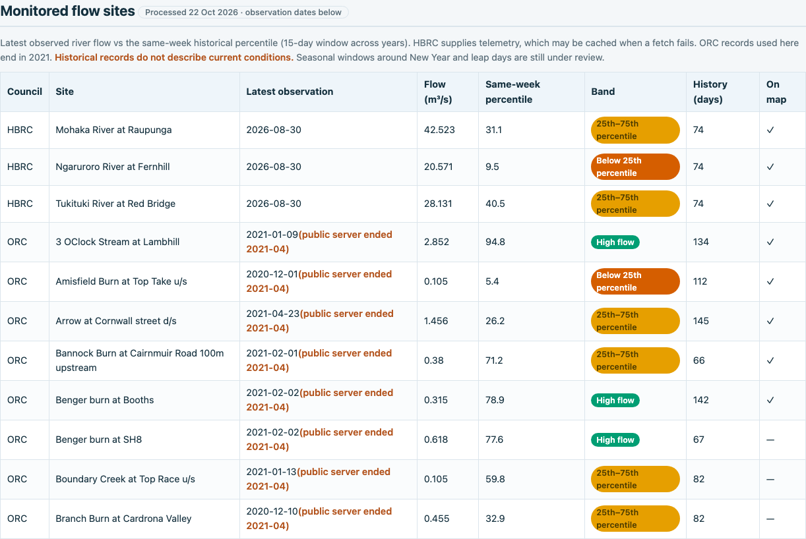
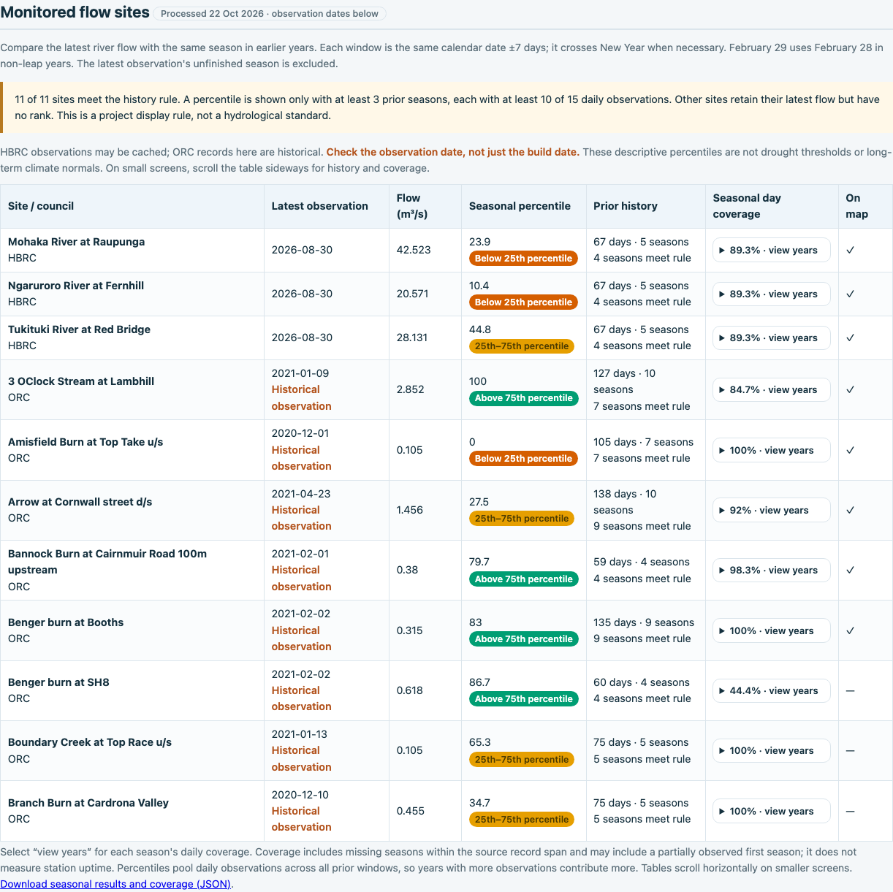

# 2026-10-23：河流比较怎样改变

这是本地修改前后的真实截图，不是线上部署记录。修改前基准是上一轮已完成、尚未提交的本地版本。
本轮分两步进行，每一步都在动手前拍摄，检查后再拍；桌面和手机各保留一组。

前后使用同一份原始快照，并将计算时点固定为 `2026-10-22T08:47:19.991796+00:00`。
因此图中仍显示 10 月 22 日的处理日期；实际拍摄时间另记在清单里。这个安排是为了隔离计算和页面
改动的影响，并不是宣称来源数据刚刚更新。[输入出处与校验值](inputs.json)。

## 第一步：按真实月、日选择历史窗口

**之前：** 把日期换成“一年中的第几天”，会在跨年和闰年附近选错部分日期。
**之后：** 每年按相同月、日取前后七天，允许窗口跨越 12 月和 1 月。
2 月 29 日在非闰年对应 2 月 28 日，作为明确记录的项目约定。
这一步先保留原来的样本资格规则，便于单独看到日期修正的影响。

例如，Branch Burn 的百分位由约 **32.9 变为 31.7**。观测流量没有变，变化来自历史日期的选择。
截图中的其他地方可能看不出区别；当时的 JSON 和清单也一并保留。

| 修改前 | 修改后 |
|---|---|
|  |  |

[手机修改前](01-seasonal-window/before/mobile.png) · [手机修改后](01-seasonal-window/after/mobile.png) ·
[修改前数据](01-seasonal-window/before/flow_percentile.json) · [修改后数据](01-seasonal-window/after/flow_percentile.json)

## 第二步：说明历史覆盖，不给过少的样本排名

**之前：** 主要显示历史有多少天，五天就能获得颜色分组；当前未结束季节中的前几天也进入历史比较。
**之后：** 排除本次观测所在的未结束季节；同时显示有效天数、来自多少个季节、多少季节达到筛选条件，
并可展开每个年份查看。中间完全缺失的季节也留在覆盖率分母中。

最低展示条件是至少三个历史季节，每个至少十天有效观测。未达到时仍显示最新流量，
但百分位显示“暂无数据／历史不足”。这是项目的筛选规则，不是水文学标准，更不代表干旱诊断。
满足条件后仍按所有已完成历史窗口的有效日值合并比较，各年贡献随观测数量不同。

Benger Burn at SH8 有四个达到条件的季节，但包含中间缺失季节后，日数覆盖率只有 **44.4%**。
“有几年资料”和“资料是否连续完整”是两件事，页面现在让读者能同时看到。

| 修改前 | 修改后 |
|---|---|
|  |  |

[手机修改前](02-history-coverage/before/mobile.png) · [手机修改后](02-history-coverage/after/mobile.png) ·
[修改前数据](02-history-coverage/before/flow_percentile.json) · [修改后数据](02-history-coverage/after/flow_percentile.json)

手机截图记录表格的初始横向位置。新表格保持可读的列宽，可以向右滚动查看排名和历史覆盖；
展开年份的操作也已经检查。完整的字段与数值见上面的桌面图和 JSON。

## 数字变化应怎样理解

| 站点 | 本轮开始时 | 第一步后 | 第二步后 | 说明 |
|---|---:|---:|---:|---|
| Branch Burn at Cardrona Valley | 32.9 | 31.7 | 34.7 | 先纠正日期，再剔除当前未结束季节；两个改动影响不同 |
| Mohaka River at Raupunga | 31.1 | 31.1 | 23.9 | 排除当前季节后，比较样本改变；不表示河流在本轮期间突然变干 |
| Bannock Burn at Cairnmuir Road | 71.2 | 71.2 | 79.7 | 历史参考样本变化，观测流量和观测日期不变 |

以上是百分位，不是水量变化百分比。ORC 数据仍是历史观测，不能用图中颜色判断当前状况。
完整版的 11 个站点都达到本项目最低规则；小型离线示例的两个站点因摘选样本过少，都不显示排名。

## 验证与边界

- 61 项测试在离线示例和完整本地快照上通过，没有跳过。
- 独立的 Python 日期计算逐项核对 SQL 的季节范围、逐年天数、覆盖率、统计值、排名及分组。
- 跨年、闰日、缺整年、只有一两年、稀疏年份、无历史、零流量、并列值及 25/75 边界均有测试。
- 桌面与手机的六个页面、年份展开、横向滚动及地图历史说明均检查通过，无脚本错误或页面溢出。
- 没有抓取新来源数据，没有提交或部署。真实季节代表性、站点运行年限及水资源决策仍需更多证据。

以后按同样的[快照流程](../README.md)继续记录。没有历史配对画面的旧改动，不作事后伪造。
