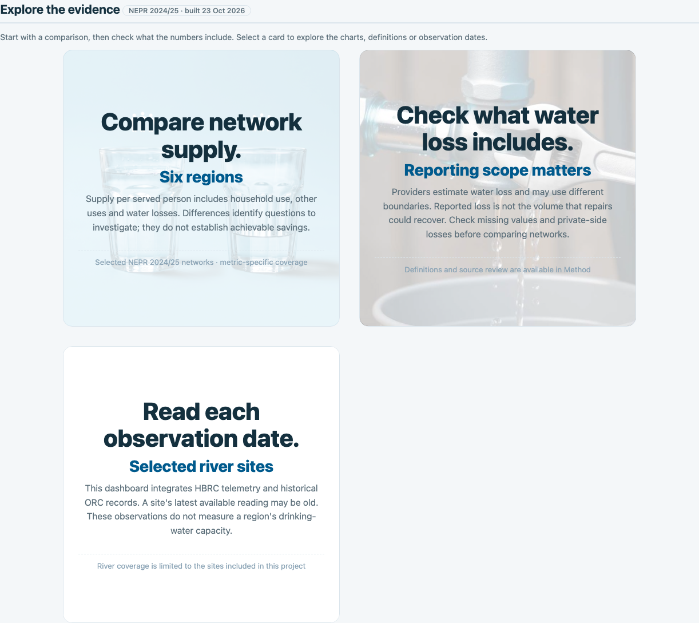
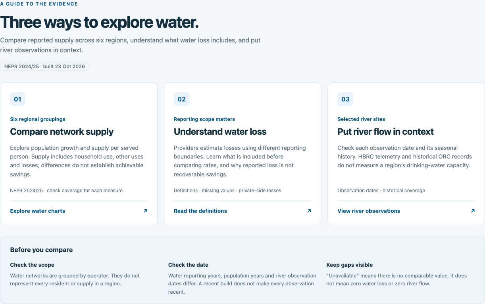

# 2026-10-24：首页阅读路径预览

本日第一步：首页从大幅提示卡片改为三个明确的浏览入口。
指标计算、数据、其他页面的图表保持原样。此预览在 `frontend/overview-preview` 分支，
基于已经推送到 main 的 `533b527`。分支预览与线上部署是两个不同状态。

## 为什么改

旧首页的方形卡片占用较多空间，悬停会放大并使其他卡片变淡，
不便同时比较三个入口。新首页先解释能研究什么，再说明每个入口能看到什么。

- 桌面三列展示供水、漏损定义和河流观测；窄屏纵向排列。
- 每张卡片增加明确的操作文字，保留来源年份与解释限制。
- 下方集中说明比较前要检查范围、日期和缺失值。
- 卡片改为原生按钮，支持 Enter、空格和可见的键盘焦点；跳转后焦点进入目标标题。

## 修改前后

截图为同一 Overview 区域；页面顶部和侧栏未调整，因此不在截图范围内。
桌面视口 1440×1000，手机 390×844，区域实际高度随内容变化。
两组清单记录的全部页面数据文件校验值完全一致，没有刷新数据。

| 画面 | 修改前 | 修改后 |
|---|---|---|
| 桌面 | [查看原图](01-overview/before/desktop.png) | [查看原图](01-overview/after/desktop.png) |
| 手机 | [查看原图](01-overview/before/mobile.png) | [查看原图](01-overview/after/mobile.png) |
| 数据与版本记录 | [修改前清单](01-overview/before/manifest.json) | [修改后清单](01-overview/after/manifest.json) |

### 桌面修改前

### 桌面修改后

## 验证与后续

检查三种宽度（1440、820、390）的六个页面、卡片跳转、Enter/空格操作和跳转焦点；
另检查 JavaScript 语法、页面报错与横向溢出。结果记录在中文修改日志。
这一步是首页信息结构预览，后续再处理整站视觉风格、导航和各图表的阅读体验。

## 第二步：确定受众并增加双语公众版

[查看第二步的说明与中英文快照](02-public-bilingual/README.md)。
